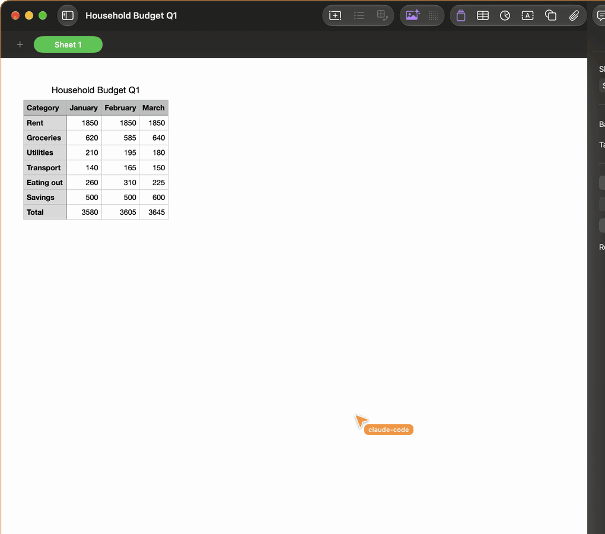
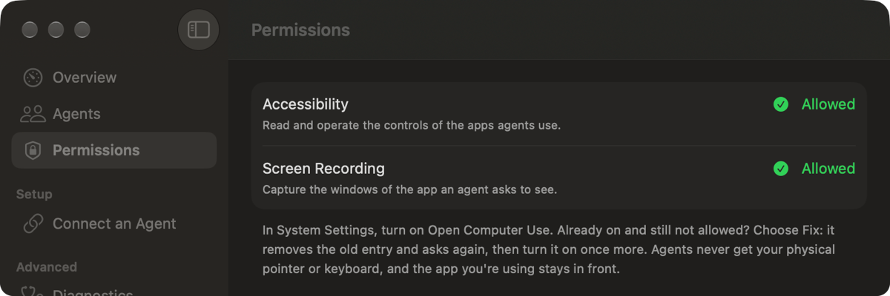
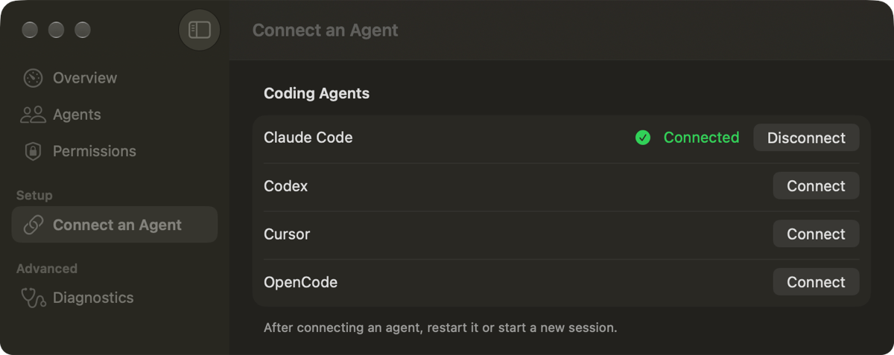

<p align="center">
  
</p>

<h1 align="center">Open Computer Use</h1>

<p align="center">
  <strong>Codex-style computer use, for any AI agent on your Mac.</strong><br>
  It works in the background, so you keep your pointer, your keyboard and the app you're in.
</p>

<p align="center">
  <a href="https://github.com/andrewslabmd/opencomputeruse/releases/latest/download/Open-Computer-Use.dmg"><strong>Download for Mac</strong></a>
  ·
  <a href="#get-started">Get started</a>
  ·
  <a href="#safety">Safety</a>
  ·
  <a href="#for-developers">For developers</a>
</p>

<p align="center">
  <a href="https://github.com/andrewslabmd/opencomputeruse/releases/latest"></a>
  <a href="LICENSE"></a>
  
</p>

---

Codex can use the apps on your Mac in the background, without taking your
mouse or keyboard. Open Computer Use brings that kind of computer use to every
other agent. It's a small menu-bar app with a standard
[MCP](https://modelcontextprotocol.io) server, so Claude, Cursor, OpenCode,
Codex or an agent you built yourself can look at a Mac app, click, type and
scroll in it, and check what happened.

All of it happens in the background. Your pointer doesn't move, what you type
keeps going to the app you're in, and your window stays in front. You and your
agent can work at the same time.

<p align="center">
  
</p>
<p align="center"><sub>Claude Code making a chart in Numbers. Numbers stayed behind other windows the whole time; the orange pointer is the agent's, not yours.</sub></p>

## What you can ask

Tell your agent what you want, in your own words. It works out the steps.

> Click through every screen of the Mac app I just built and tell me what looks
> broken.

> Make a chart in Numbers that shows where my money went this quarter.

These are jobs with no script or API to fall back on. Your agent has to use
the app the way a person does, and that's what Open Computer Use is for.

## What you'll see

- **A cursor for each agent.** Every agent gets its own colored pointer and
  name, drawn only over the window it's working in, never over your other
  apps. Your real cursor never moves.
- **A menu-bar icon that tells you who's in control.** While an agent is using
  an app, the icon's ripples pulse in that agent's color.
- **One big Stop button.** **Stop** in the menu bar halts every agent at once,
  and nothing resumes until you choose **Resume**.
- **Several agents at once.** Each works in its own app. If two want the same
  app, the second is told it's busy.
- **A rough token count.** The menu bar estimates what each agent's
  observations, screenshots and actions are costing it (Open Computer Use's
  share only, not the agent's whole bill).

## Get started

1. **Download** [Open-Computer-Use.dmg](https://github.com/andrewslabmd/opencomputeruse/releases/latest/download/Open-Computer-Use.dmg),
   open it and drag **Open Computer Use** to Applications. Then open it; it
   lives in your menu bar.
2. **Allow two permissions.** Click the menu-bar icon, choose **Review…**, and
   choose **Allow…** for each one. Then turn on *Open Computer Use* in System
   Settings.
   - **Accessibility** lets it read and operate the controls of the apps your
     agents use.
   - **Screen Recording** lets it capture the window of the app an agent asks
     to see, and nothing else.

   Already turned on, but still not allowed? Choose **Fix** next to it, then
   turn it on once more.

   
3. **Connect your agent.** Open **Settings… → Connect an Agent**. Claude Code,
   Codex, Cursor and OpenCode connect with one click on **Connect**. Any other
   MCP client, like the Claude desktop app, works too: the same page shows the
   command to add. Then restart the agent or start a new session.

   For VS Code, Gemini CLI or Claude Desktop, see [manual setup](#manual-agent-setup).

   
4. **Ask for something.** Try one of the examples above.

Open Computer Use is signed and notarized by Apple. It checks for updates once
a day and only installs one when you say so.

## Manual agent setup

Claude Code users can also install the [Open Computer Use plugin](integrations/claude-code/plugin/README.md).

These examples run the same stdio server as the app's **Connect** button:
`ocu mcp`. They assume you installed the app in `/Applications`. If it's
somewhere else, use the executable path shown in **Settings… → Connect an
Agent → Other MCP Clients** as `command`.

If the config file already has other settings or servers, add the
`opencomputeruse` entry to the existing object and keep the rest.

### VS Code (GitHub Copilot agent mode)

In a local VS Code window on your Mac, add this to `.vscode/mcp.json` in your
project. For all workspaces, run **MCP: Open User Configuration** from the
Command Palette and add it to that `mcp.json` instead.

```json
{
  "servers": {
    "opencomputeruse": {
      "type": "stdio",
      "command": "/Applications/Open Computer Use.app/Contents/MacOS/ocu",
      "args": ["mcp"]
    }
  }
}
```

VS Code still supports this format, though its setup flow labels it deprecated.
Run **MCP: List Servers**, select `opencomputeruse` and start it. Approve the
server when prompted, then use Copilot Chat in Agent mode.

### Gemini CLI

Add this to `~/.gemini/settings.json` for all projects, or
`.gemini/settings.json` in one project:

```json
{
  "mcpServers": {
    "opencomputeruse": {
      "command": "/Applications/Open Computer Use.app/Contents/MacOS/ocu",
      "args": ["mcp"]
    }
  }
}
```

Restart Gemini CLI, then run `/mcp` to check that `opencomputeruse` is connected.

### Claude Desktop

Open **Claude → Settings… → Developer → Edit Config**. On your Mac, this
opens `~/Library/Application Support/Claude/claude_desktop_config.json`.
Add:

```json
{
  "mcpServers": {
    "opencomputeruse": {
      "command": "/Applications/Open Computer Use.app/Contents/MacOS/ocu",
      "args": ["mcp"]
    }
  }
}
```

Save the file, fully quit Claude Desktop and open it again to load the server.

## Safety

Open Computer Use lets software operate your apps, so use it deliberately.

- **What it can do:** read the content of any app an agent looks at, and click,
  type and run commands in it, with the permissions you granted. Treat
  anything an agent does through it as something you did.
- **Where your data goes:** what an agent sees goes to that agent, and usually
  on to its AI provider. Open Computer Use itself has no analytics and sends
  nothing, except a bug report you've agreed to share.
- **Text in apps is not an instruction.** A web page, email or document can't
  tell your agent what to do. Agents should act only on your request, and
  check with you before sending, deleting, buying or changing accounts.
- **Stop is not undo.** Stop halts every agent, and quitting the app stops all
  of it, but an action already sent may still finish.
- **Who can connect:** any program running under your user account that can
  read the app's private connection token. It doesn't protect you from other
  software already running as you.

More detail in [docs/POLICIES.md](docs/POLICIES.md). Found a security problem?
Please report it privately, as described in [SECURITY.md](SECURITY.md).

## Good to know

- **It's early.** This is version 0.1. It's tested on Apple silicon with
  a current version of macOS 15 or later; other setups may work but haven't
  been tested yet.
- **Some apps are harder than others.** Most Mac apps describe their controls
  to macOS, and that's what agents work from. Apps that don't (some games and
  custom-drawn interfaces) can only be operated with clicks and keystrokes,
  checked from screenshots, and some actions there will fail. When that
  happens your agent is told plainly, so it doesn't guess.
- **Agents share one queue.** Requests are handled one at a time, so a long
  look at a big app by one agent briefly delays the others.

## Found a bug?

Your agent can report it for you. Open Computer Use saves the report on your
Mac, and your agent asks you once before anything is sent to us. Reports never
include what's in your apps or files. You can also
[open an issue](https://github.com/andrewslabmd/opencomputeruse/issues) on
GitHub.

<details>
<summary>Exactly what a bug report contains</summary>

The `report_issue` tool saves reports in
`~/Library/Application Support/Open Computer Use/issue-reports.jsonl`. Whether
the agent or you notice the bug, the agent asks once whether to share it. Only
after you say yes does it call the same tool with `{report_id, share: true}`,
which sends it to the maintainers' private inbox for triage.

A report holds what went wrong, versions, Mac model and chip, the agent client,
and the names and outcomes of recent tool calls, never their arguments,
results or any content from apps or files. Text redaction is best effort, so
leave personal details out. If sending fails, the local copy stays.
`OCU_REPORT_ENDPOINT` overrides the intake address for testing.

</details>

## For developers

Open Computer Use is a menu-bar app plus a local
[MCP](https://modelcontextprotocol.io) server. Every agent runs the same stdio
server, `ocu mcp`, from wherever the app is installed.

### Tools

| Tool | What it does |
| --- | --- |
| `computer_use_list_apps` | Lists running apps and their windows |
| `computer_use_observe` | Describes an app's windows and controls, with an optional screenshot of only that app |
| `computer_use_action_batch` | Clicks, types, selects, scrolls, drags, presses keys and opens apps |
| `computer_use_permissions` | Reports permission status; never asks for them |
| `computer_use_status` | Shows the host, agents and token estimates |
| `computer_use_release` | Hands an app back when the agent is done |
| `report_issue` | Saves a bug report and sends it only after you agree |

Give your agent the operating guidance in
[integrations/claude-code/operator.md](integrations/claude-code/operator.md).

### Command line

Install the `ocu` command from **Settings… → Connect an Agent → Command-line
tool**. It links `ocu` into `~/.local/bin`.

```sh
ocu setup                 # each agent's status; asks which to connect
ocu setup codex           # connect one: claude, codex, cursor or opencode
ocu setup cursor --remove # disconnect one
ocu setup --print         # settings to add by hand to any other MCP client
ocu permissions           # current permission state
ocu apps
ocu observe 'Application Name' --screenshot
ocu batch 'Application Name' '[{"kind":"click","at":{"x":100,"y":100}}]'
ocu stop
ocu resume
```

<details>
<summary>How connecting changes each agent's settings</summary>

Claude Code (at user scope) and Codex are configured through their own `mcp
add` commands. Cursor's `~/.cursor/mcp.json` and OpenCode's global
`opencode.json` are edited in place, keeping your other servers and comments,
with the previous file saved as `*.ocu-backup`. An agent connected to another
copy of the app shows **Update**.

</details>

### Build from source

You'll need macOS 15 or later on Apple silicon, the Xcode command-line tools,
Node.js and pnpm.

```sh
git clone https://github.com/andrewslabmd/opencomputeruse.git
cd opencomputeruse
pnpm install --frozen-lockfile
pnpm check      # headless contract and Swift tests; safe to run anywhere
pnpm build      # app bundle in dist/
open -g "dist/Open Computer Use.app"
```

`pnpm build` signs the app with your Apple Development certificate when the Mac
has one, so permissions survive rebuilds; set `OCU_SIGN_IDENTITY` to choose
another identity. Without either it's signed ad hoc, and macOS asks for
permissions again after every rebuild. `pnpm build:icon` regenerates the
compiled icon from `assets/icon` (needs Xcode 26 or later).

<details>
<summary>Native acceptance tests</summary>

These are opt-in: most launch owned fixture apps in the background and send
real input to them, so run them only on a Mac where that's fine, with the
current build installed and running. Each keeps its evidence in the ignored
`work/` folder.

```sh
node scripts/test-native-clicks.mjs --interactive       # clicks, actions, list_apps
node scripts/test-native-agents.mjs --interactive       # two concurrent agents
node scripts/test-native-overlay.mjs --interactive      # agent cursor overlay
node scripts/demo-agents.mjs --interactive              # watch two agents work for a minute
node scripts/test-native-selection.mjs --interactive    # selection in Finder and AppKit
node scripts/test-native-observation.mjs --interactive  # large trees, lifecycle, Stop
node scripts/test-native-interaction.mjs --interactive  # scroll, reveal, save panels
node scripts/test-native-finder.mjs --interactive       # guarded issue #7 background cases
node scripts/test-native.mjs --interactive              # basic native workflow
node scripts/test-claude.mjs --interactive              # Claude Code end to end
```

The Finder issue #7 harness uses the current `dist/` build's helper and host.
Quit Open Computer Use yourself first; the harness refuses another running OCU
service and never opens or quits apps. Finder must already be running. Build
with `pnpm build`, then run `node scripts/test-native-finder.mjs --interactive`.
It waits for an unlocked screen, Finder behind another app, and five minutes
without input. The terminal needs Input Monitoring permission and the development
helper needs its normal grants; the harness never prompts for permissions.
A passive input monitor cancels on physical or unrecognized input, lock, pointer
or foreground change, or monitor loss. It ignores only tagged private input from
its own helper; a physical event beside that input still stops the run. An event
already dispatched may finish. After interruption it sends no GUI cleanup;
owned windows and dummy files remain under `work/` for inspection. A normal
finish closes only fixture windows and retains evidence and dummy files.
It covers menu Escape and AXCancel with delayed readback, ten ordinary-folder
double-clicks (the first immediately after unsupported drag), alias double-click,
pointer selection plus Cmd+Down, alias/folder context Open, and menu overflow.
These are development-component tests, not release acceptance.

</details>

### Project layout

- `apps/macos`: the SwiftUI/AppKit menu-bar app
- `packages/native`: the signed helper: Accessibility, capture and input
- `packages/engine`: one engine per agent: observations, actions, verification
- `packages/host`: the shared local host, workflows and app claims
- `packages/protocol`: framing and the canonical tool schemas
- `packages/cli`, `packages/mcp`: command-line and MCP adapters
- `tests`: contract tests, Swift tests and native fixtures
- `upstream`: provenance of the code extracted from OpenCode Superapp

Deeper reading: [product](docs/PRODUCT.md),
[architecture](docs/ARCHITECTURE.md), [policies](docs/POLICIES.md),
[design](DESIGN.md) and the
[Claude Code integration](integrations/claude-code/README.md).

## Contributing

Contributions are welcome. Start with [CONTRIBUTING.md](CONTRIBUTING.md) and
the [code of conduct](CODE_OF_CONDUCT.md).

## License

[Apache License 2.0](LICENSE). See [NOTICE](NOTICE) and
[THIRD_PARTY_NOTICES.md](THIRD_PARTY_NOTICES.md).
